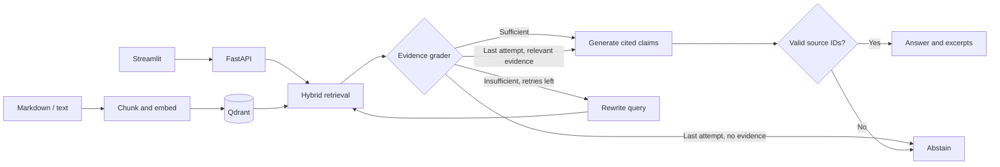

# Agentic Corrective RAG

[](.github/workflows/checks.yml)


A retrieval-augmented question-answering system that **grades its own evidence before it answers**. It runs hybrid retrieval (dense embeddings + BM25), asks a grader whether the passages can support an answer, rewrites the query and retries when they cannot, and abstains when the evidence never arrives. Every claim in an answer carries a citation that is validated mechanically against the retrieved passages.

The pipeline is built with LangGraph, Qdrant, FastAPI and Streamlit, traced with Langfuse, and evaluated head-to-head against a plain RAG baseline with RAGAS. The default stack runs fully offline on a laptop (Ollama + Qwen3.5 4B). An OpenAI profile is included for hosted deployment.

## Headline results

RAGAS 0.4.3, 26 paired questions (16 answerable, 10 unanswerable), same index, same generator, same prompt. Local judge: Qwen3.5 4B with Qwen3 Embedding 0.6B. RAGAS means cover the 16 answerable questions only. The corrective rows differ only in the grader (rule, prompt or model). Baseline numbers in this table come from the first run; the same baseline scored 0.875 faithfulness in the last run, which shows the judge noise (about 0.03) on identical settings.

| Variant | Faithfulness | Answer relevancy | Context precision | Context recall | Rewrites | Median latency (s) | Correct abstentions |
| --- | ---: | ---: | ---: | ---: | ---: | ---: | ---: |
| Baseline RAG | **0.9062** | **0.8085** | 0.9583 | **0.9375** | 0/26 | **2.8** | 4/10 |
| Corrective, `majority` rule (original) | 0.8646 | 0.7911 | **0.9687** | 0.9219 | 22/26 | 15.2 | 3/8 |
| Corrective, `any` rule | 0.8021 | 0.7919 | **0.9687** | 0.9219 | 5/26 | 6.4 | 4/10 |
| Corrective, `any` rule + few-shot grader | 0.7556 | 0.7349 | 0.9062 | 0.8698 | 4/26 | 7.1 | 4/10 |
| Corrective, `any` rule + Qwen3 8B grader | 0.8229 | 0.7975 | 0.9583 | **0.9635** | 2/26 | 9.0 | 3/9 |

**Honest reading.** The corrective graph still did not beat the baseline on any quality metric, but the cause of the extra rewrites is now identified.

- **The routing rule, not the grader, drove the rewrites.** The original rule needs half of the retrieved passages approved. This corpus has three one-chunk files and retrieval returns all three, so a question answered by one file can never pass. In the `majority` run, 38 of 45 rewrites happened with at least one passage approved (`below_threshold`) and only 7 with none. The `any` rule cut rewrites from 22/26 to 5/26 and median latency from 15.2 s to 6.4 s.
- **Faithfulness did not recover.** It fell from 0.865 to 0.802 even though the evidence handed to the generator is nearly the same. With 16 pairs and a 4B judge, differences of a few hundredths to 0.06 are within noise, so do not read the ordering of those two rows.
- **Few-shot examples hurt** the 4B grader (more invalid verdicts, one false abstention).
- **A larger grader (Qwen3 8B) changed little.** It cut rewrites to 2/26 and raised context recall to 0.9635, but faithfulness (0.823) and abstention (3/9, one case lost to a `ValidationError` during generation) stayed in the same range. Median latency (9.0 s) is higher than the 4B `any` run, probably because Ollama swaps models on a 16 GB machine; this was not isolated.
- **Unanswerable questions: no benefit measured.** Both systems abstained on only 4 of 10 and hallucinated on 6. The grader approves a loosely related passage, and the generator then answers from it. Only the `majority` run lost two cases to errors (3/8 pairs), so treat that row's abstention count with care.
- **Not tested yet:** a reranker, a bigger corpus, a stronger judge, and the 8B grader with the `majority` rule.

[Summary (majority)](evals/results/20261106T050905843852Z/summary.md) · [Summary (any)](evals/results/20261106T055244485686Z/summary.md) · [Summary (any + few-shot)](evals/results/20261106T061552531256Z/summary.md) · [Summary (8B grader)](evals/results/20261106T193356755207Z/summary.md) · [Earlier 16-question run](evals/results/20261105T221454627783Z/summary.md). Each directory also holds `results.json`, `results.csv` and `traces.jsonl` (with per-passage grader verdicts). Reproduce a row with `GRADE_RULE=any python -m src.eval.run_evaluation --judge-provider ollama --label any-v1`, then compare runs with `--compare RUN_DIR...`.

## Demo

### Streamlit workspace


Pick a sample question and open any numbered citation to read the exact passage. **Percurso do agente** shows the original search, each rewritten query, and which passages passed grading on every attempt. **Modo debug** exposes the full final LangGraph state. The interface text is in Portuguese; the documents and answers follow the language of the corpus.

### Langfuse trace


> Both images are placeholders. To replace them, run the stack, take a screenshot of the UI and of one trace, save them as `assets/streamlit-preview.png` and `assets/langfuse-trace-preview.png`, and update the two image links above.

## How it works



1. **Index.** The indexer splits UTF-8 Markdown and text into overlapping passages and stores them in a Qdrant collection with named dense and sparse vectors. A new collection is published through an atomic alias swap, so a failed rebuild leaves the previous index serving traffic.
2. **Retrieve.** Qdrant ranks passages by cosine similarity (dense) and by built-in BM25 (sparse). Reciprocal rank fusion merges the two rankings without comparing raw scores.
3. **Grade.** One LLM call returns a binary relevance verdict per passage, judged against the **original** question. If at least half pass, only the approved passages go forward.
4. **Correct.** If too few pass, the query is rewritten (the original question is preserved for grading and generation) and retrieval repeats, up to `MAX_REWRITES` times.
5. **Generate.** The model returns individual claims tagged with passage IDs. Application code resolves each ID against the approved passages and renders citations such as `[1]`. An unknown or missing ID produces an abstention.
6. **Abstain.** After the last attempt, the graph answers only from passages that were approved, and abstains when none were.

Citation checking is mechanical (the cited passage exists and was approved). Whether a passage actually entails the claim is measured by the RAGAS faithfulness score.

### Question types the system targets

| Question type | Example | Expected behavior |
| --- | --- | --- |
| Exact lookup | What does error ARC-17 mean? | Find the identifier and cite its definition. |
| Paraphrase | How long can I recover an erased archive? | Match the retention policy despite different wording. |
| Missing evidence | What is the enterprise subscription price? | Abstain if the corpus cannot establish a price. |

### Default configuration

| Setting | Ollama quickstart |
| --- | --- |
| Chat model | `qwen3.5:4b` |
| Dense embeddings | `qwen3-embedding:0.6b` |
| Candidate depth per retriever / fused passages | 12 / 4 |
| Maximum query rewrites | 2 (three retrieval attempts total) |
| Chunk size / overlap | 1,200 / 200 characters |

Grader variants: `GRADE_RULE` (`majority` or `any`), `GRADER_PROMPT` (`v1` or `fewshot`) and `GRADER_MODEL` (separate grader model, default the chat model). Defaults live in [configs/defaults.toml](configs/defaults.toml). Environment overrides are listed in [.env.example](.env.example).

## What makes this project strong for AI Engineer roles

| Skill | Where to look |
| --- | --- |
| **Agentic / corrective RAG.** A LangGraph state machine with conditional routing, a bounded retry budget, query rewriting and an explicit abstention path. | [src/agents/graph.py](src/agents/graph.py) |
| **Hybrid retrieval.** Dense + BM25 in one Qdrant query, fused with RRF, with zero-downtime reindexing through collection aliases. | [src/retrieval/hybrid.py](src/retrieval/hybrid.py), [src/ingestion/index.py](src/ingestion/index.py) |
| **Rigorous evaluation.** Paired baseline vs corrective comparison with RAGAS, pinned index snapshot, dataset hash, per-case traces, pair counts, and a report that shows a negative result instead of hiding it. | [src/eval/](src/eval), [evals/](evals) |
| **Observability.** Langfuse traces per graph node, token and cost accounting, user feedback scores tied to traces, and local metrics that work with tracing disabled. | [src/observability/tracing.py](src/observability/tracing.py) |
| **Professional UI.** Streamlit workspace with citations, correction history, run history, debug state and feedback. | [app/main.py](app/main.py) |
| **Docker and deployability.** Multi-stage image, non-root user, healthchecks, Compose profiles for dev, proxy (Caddy HTTPS) and eval, plus PaaS recipes. | [docker/](docker), [compose.yaml](compose.yaml) |
| **Modular, documented, tested code.** Provider abstraction (Ollama or OpenAI), typed settings, offline test suite (44 tests, coverage gate), ruff and pytest in CI. | [src/](src), [tests/](tests), [.github/workflows/checks.yml](.github/workflows/checks.yml) |

## Quickstart

### Requirements

Docker with the Compose plugin and [Ollama](https://ollama.com/download) running on the host. For host development, Python 3.11 or 3.12.

### Run with Docker

```bash
ollama pull qwen3.5:4b
ollama pull qwen3-embedding:0.6b
make up   # creates .env if missing, builds, starts Qdrant, API and UI
```

On first start the API indexes the bundled corpus when its collection is missing or empty (`AUTO_INDEX=false` disables this). Without `make`: `cp -n .env.example .env && docker compose up -d --build --wait`.

| Service | URL |
| --- | --- |
| Streamlit UI | <http://localhost:8501> (`UI_PORT`) |
| API and docs | <http://localhost:8000/docs> (`API_PORT`) |
| Liveness | `GET /health` (API), `GET /_stcore/health` (UI) |
| Readiness (index exists for the configured embedding model) | `GET /ready` |

Containers reach Ollama through `OLLAMA_DOCKER_URL` (default `http://host.docker.internal:11434`). On Linux, bind Ollama to an interface reachable from the Docker bridge and restrict access to that bridge.

To use OpenAI instead, set `MODEL_PROVIDER=openai` and `OPENAI_API_KEY` in `.env`, remove model overrides (defaults are `gpt-4o-mini` and `text-embedding-3-small`), and run `docker compose up -d api`. Each provider uses its own collection alias.

### Run on the host

```bash
python3.11 -m venv .venv
source .venv/bin/activate
pip install -r requirements.txt
docker compose up -d --wait qdrant
python -m src.ingestion.index assets/corpus
uvicorn src.api.main:app --port 8000
# In another activated shell:
streamlit run app/main.py
```

### Ask a question

```bash
curl -sS http://localhost:8000/query \
  -H 'Content-Type: application/json' \
  -d '{"question":"What does ARC-17 mean?"}'
```

The response contains `answer`, `citations`, `abstained`, `rewrites` and an `observability` object (latency, tokens, estimated cost). An abstention is a successful response. An unavailable dependency returns HTTP 503. You can also run the graph directly:

```bash
python -m src.agents "What does ARC-42 mean and how many exports can a workspace run at once?"
```

### Bring your own documents

Pass a directory of Markdown or text files to the indexer. Each run replaces the **whole corpus** behind the configured alias, and changing the embedding model requires a reindex.

```bash
python -m src.ingestion.index path/to/my-docs
```

With Compose, mount the directory on the one-off container: `docker compose run --rm -v "$PWD/my-docs:/corpus:ro" api python -m src.ingestion.index /corpus`.

## Evaluation

```bash
pip install -r evals/requirements.txt
python -m src.eval.run_evaluation                          # OpenAI judge (needs OPENAI_API_KEY)
python -m src.eval.run_evaluation --judge-provider ollama  # fully local judge
make eval ARGS="--judge-provider ollama"                   # same, inside the container
```

The [golden set](evals/golden_set.jsonl) holds 16 answerable questions about the bundled runbook: recovery deadlines, error remediation and cases that need two documents. Both systems receive only the question and share the same index snapshot, retrieval settings, chat model and answer prompt. The baseline runs one search and passes all ranked passages to the generator. The corrective graph grades, may rewrite, and passes only approved evidence.

Each run writes a UTC-stamped directory under `evals/results/` with `results.json` (models, snapshot, dataset hash, scores), `results.csv`, `traces.jsonl` (generation recorded before judging, independent of Langfuse) and `summary.md`.

How to read the scores: faithfulness is judged against the evidence given to the generator, answer relevancy against the original question, and context precision and recall against the reference answer. A genuine abstention has no faithfulness score. Per-metric means use only questions with valid values for both systems, so read the pair counts alongside the scores. Model calls use bounded retries; an exhausted call leaves a missing score, the run continues, and a partial run exits with status 1.

The [golden set](evals/golden_set.jsonl) now also holds 10 unanswerable questions (`"answerable": false`, no reference answer). They are scored on abstention instead of RAGAS: correct abstention, hallucination, and false abstention on the answerable questions. The [smoke set](evals/smoke.jsonl) covers unanswerable questions and the rewrite-budget ablation: `python -m src.eval.run --max-rewrites 0 --output runs/graded-single-pass.json`.

Offline checks (no model or network needed):

```bash
pip install -r tests/requirements.txt
pytest -q --cov && ruff check . && ruff format --check .
```

Set `TEST_QDRANT_URL=http://localhost:6333` to include the Qdrant integration test. It creates and removes isolated collections.

## Observability with Langfuse

Every query returns latency, token counts and estimated provider cost, and logs a `rag_query` line, even with tracing disabled. To export traces, add the following to `.env` (Langfuse Cloud or self-hosted) and restart the API:

```dotenv
LANGFUSE_PUBLIC_KEY=pk-lf-...
LANGFUSE_SECRET_KEY=sk-lf-...
LANGFUSE_BASE_URL=https://cloud.langfuse.com
LANGFUSE_TRACING_ENVIRONMENT=development
```

Ask **What does ARC-17 mean?**, then open the trace from the UI or filter by `corrective-rag` in Langfuse. Each node records input, output and duration. A condensed trace from the local demo corpus (routes vary between runs):

```text
corrective-rag
└── rag-graph
    ├── retrieve          3 passages, including errors.md
    ├── grade_documents   1 of 3 relevant → decide_to_generate: rewrite_query
    ├── rewrite_query
    ├── retrieve          3 passages
    ├── grade_documents   1 of 3 relevant → decide_to_generate: rewrite_query
    ├── rewrite_query
    ├── retrieve          3 passages
    ├── grade_documents   1 of 3 relevant → decide_to_generate: generate_answer
    └── generate_answer   cites errors.md, chunk 1
```

That query took 31 s on a local 4B model and used 1,798 tokens across three searches. Thumbs up/down in the UI post a `user_feedback` score to the trace through `POST /feedback`, authenticated by a signed token. Evaluation runs create one trace per case, filterable by `evaluation-baseline` or `evaluation-corrective`.

Cost estimates use per-million-token rates (defaults match GPT-4o mini and text-embedding-3-small; override with `CHAT_INPUT_USD_PER_MILLION`, `CHAT_OUTPUT_USD_PER_MILLION`, `EMBEDDING_USD_PER_MILLION`). Infrastructure, caching, ingestion and judge calls are excluded. Enabling tracing sends questions, passages and model output to the configured project, so restrict access and set retention to match your corpus policy. Langfuse is not bundled in Compose because self-hosting needs PostgreSQL, ClickHouse, Redis and object storage; follow the [self-hosting guide](https://langfuse.com/self-hosting).

## Deployment

One multi-stage image runs every process; `SERVICE` selects `api`, `ui` or `all` (both in one container, for single-service platforms). The `eval` target adds RAGAS. Containers run as a non-root user.

| Command | What it does |
| --- | --- |
| `make up` | Build and start Qdrant, API and UI. Indexes the corpus on first start. |
| `make dev` | Same stack with `src/` and `app/` mounted and API auto-reload. |
| `make proxy` | Adds Caddy with automatic HTTPS for `DOMAIN`. |
| `make index` | Rebuild the index from `CORPUS_DIR` (default `assets/corpus`). |
| `make eval` | Run the RAGAS evaluation in the container. |
| `make logs` / `make down` | Follow logs / stop services. The Qdrant volume is kept. |

Qdrant data lives in the `qdrant-data` volume; `docker compose down -v` deletes it. Ports bind to `127.0.0.1`; set `BIND_ADDR=0.0.0.0` only behind a firewall or proxy.

> **The UI and API have no authentication.** Every visitor spends your model credits. Before publishing a URL, add authentication (a Caddy `basic_auth` block or your platform's access control) and set provider spend limits.

### Public domain on one machine

Point a DNS record at the machine, set `DOMAIN=rag.example.com` in `.env`, and run `make proxy`. Caddy obtains a certificate and serves only the UI ([Caddyfile](Caddyfile)). The API stays on the internal network.

### Hosted platforms (Render, Railway, Fly.io)

Ollama does not run on these platforms, so use `MODEL_PROVIDER=openai` with [Qdrant Cloud](https://qdrant.tech/cloud/). Deploy the Dockerfile as one service with `SERVICE=all`; the platform supplies `PORT` and the UI listens on it.

1. Create a Qdrant Cloud cluster and copy its URL and API key.
2. Set the variables in the table below on the service.
3. Deploy. The first start indexes the bundled corpus with OpenAI embeddings. For your own documents, run the indexer from your machine and set `AUTO_INDEX=false`.

Platform specifics: on **Render** use Language Docker, Dockerfile path `docker/Dockerfile`, health check `/_stcore/health`. On **Railway** set `RAILWAY_DOCKERFILE_PATH=docker/Dockerfile` and the same health check. On **Fly.io**:

```bash
fly launch --no-deploy --dockerfile docker/Dockerfile
fly secrets set MODEL_PROVIDER=openai OPENAI_API_KEY=... QDRANT_URL=... QDRANT_API_KEY=...
fly deploy
```

then set `SERVICE = "all"` under `[env]`, `internal_port = 8501` under `[http_service]`, and an HTTP check on `/_stcore/health` with a 120 s grace period.

> These recipes follow each platform's documented Dockerfile flow but **have not been exercised against live accounts**. Hybrid search relies on Qdrant's server-side BM25 inference (`cloud_inference`); confirm your plan supports it with `GET /ready` and one query after the first deploy.

| Variable | Local (Ollama) | Hosted (OpenAI) |
| --- | --- | --- |
| `MODEL_PROVIDER` | `ollama` | `openai` |
| `OPENAI_API_KEY` | not needed | **required** (secret) |
| `QDRANT_URL`, `QDRANT_API_KEY` | set by Compose | **required** (secret) |
| `SERVICE` | per service | `all` |
| `AUTO_INDEX`, `CORPUS_DIR` | `true`, `assets/corpus` | same |
| `LANGFUSE_*` | optional | optional (set all three keys) |
| `LANGFUSE_TRACING_ENVIRONMENT` | `development` | `production` |

## Repository structure

```text
app/                 Streamlit client
assets/corpus/       Fictional runbook used in the quickstart
assets/              README screenshot placeholders
configs/             Retrieval and graph defaults
docker/              Multi-stage Dockerfile and entrypoint
evals/               Golden and smoke datasets, evaluator dependencies, results
notebooks/           Reserved for exploratory analysis
src/
  agents/            LangGraph routing, prompts and grounded generation
  api/               FastAPI endpoints and resource lifecycle
  eval/              Evaluation runners and metric definitions
  ingestion/         Chunking, indexing, alias publication, first-start bootstrap
  observability/     Optional Langfuse integration
  retrieval/         Hybrid Qdrant search
tests/               Offline regression checks
compose.yaml         Qdrant, API, UI, optional proxy and eval profiles
compose.dev.yaml     Development override (mounts and reload)
Makefile             Build, run, index and evaluate shortcuts
PORTFOLIO.md         Final checklist and roadmap
```

## Limitations

- **Corrective RAG did not outperform the baseline in the measured runs.** Faithfulness fell and latency rose 2x to 5x. The extra rewrites came from the `majority` routing rule on a three-passage corpus, not from the grader. Unanswerable questions showed no gain (6 of 10 hallucinated in both systems). Broader conclusions need a stronger grader, a larger corpus and a stronger judge.
- **Small, synthetic evidence base.** The corpus is a fictional runbook and the golden set has 16 answerable and 10 unanswerable questions, each run once. Differences of a few hundredths to 0.06 are within noise, and no confidence intervals are reported.
- **Judge bias.** The local judge shares a model family with the generator and grader, and RAGAS scores from a 4B model are noisy.
- **Chunking is naive.** Character windows can split tables or procedures, and only plain text and Markdown are loaded.
- **Rewriting searches the same corpus.** Missing documents, stale policies and ambiguous questions still produce abstentions or wrong answers. A valid citation may support a claim only partially.
- **Not production-ready as shipped.** No authentication, quotas or tenant isolation. Cloud deployment recipes are untested on live accounts. Each rebuild embeds the full corpus and keeps earlier index versions.
- **UI language.** Interface labels are in Portuguese only.

## Roadmap

See [PORTFOLIO.md](PORTFOLIO.md) for the final checklist and the ordered list of future improvements.

## Acknowledgements and tech stack

README structure inspired by the [COVID-19 CT Scan Classifier](https://github.com/chrispathway/covid-ct-classifier).

Built with [LangGraph](https://docs.langchain.com/oss/python/langgraph/overview) and LangChain (orchestration), [Qdrant](https://qdrant.tech/documentation/) (dense + BM25 vectors), [Ollama](https://ollama.com) and OpenAI (models), [FastAPI](https://fastapi.tiangolo.com) and [Streamlit](https://streamlit.io) (API and UI), [Langfuse](https://langfuse.com/docs) (observability), [RAGAS](https://docs.ragas.io/) (evaluation), Docker Compose and Caddy (deployment), pytest and ruff (quality).

## License

[MIT](LICENSE)
